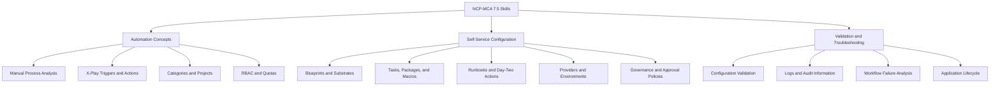
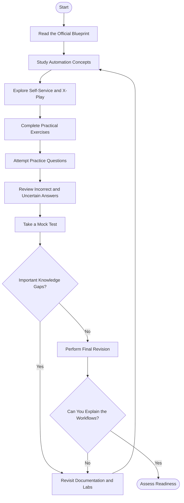
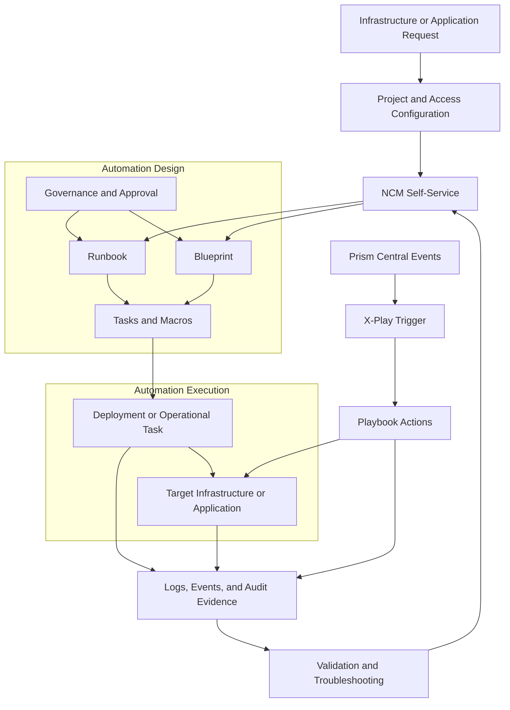
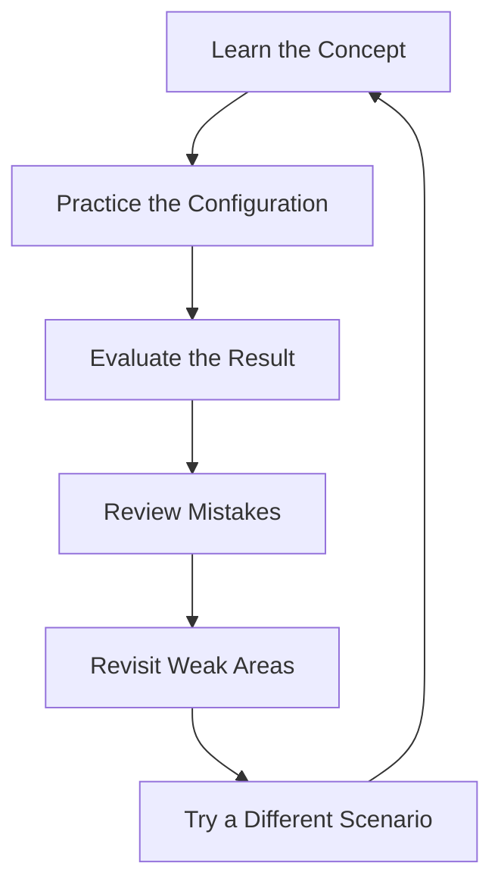
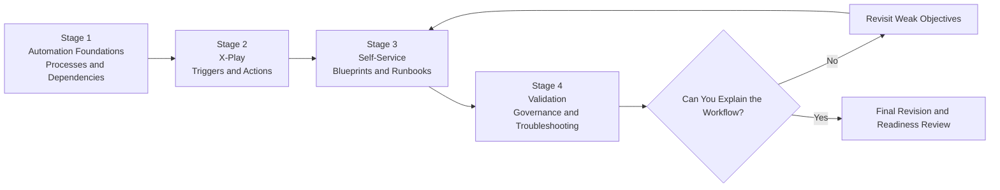
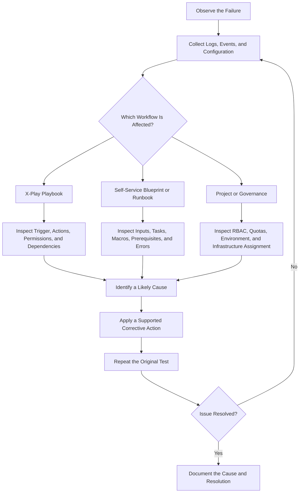

# Nutanix Certified Professional – Multicloud Automation (NCP-MCA) 7.5 Study Guide

A practical, community-oriented study guide for the **Nutanix Certified Professional – Multicloud Automation (NCP-MCA) 7.5** certification. This repository helps candidates prepare for automation workflows using Nutanix Cloud Manager (NCM), Self-Service, and X-Play.

The focus is on understanding how automation works across infrastructure and applications: designing blueprints, creating runbooks, configuring event-driven playbooks, applying governance, managing projects, and troubleshooting failed workflows.

> **Recommended study approach:** Learn the automation concepts, understand the components behind each workflow, practice configuration scenarios, review failures, and use practice questions to identify knowledge gaps.

This is an independent educational resource. Always use the current [official NCP-MCA certification information](https://www.nutanix.com/en_gb/support-services/training-certification/certifications/certification-details-nutanix-certified-professional-multicloud-automation) and [NCP-MCA 7.5 Exam Blueprint Guide](https://www.nutanix.com/content/dam/nutanix/resources/datasheets/ds-ebg-ncp-mca.pdf) as primary references.

---

## Table of Contents

- [About the Certification](#about-the-certification)
- [Who Should Prepare?](#who-should-prepare)
- [Exam Details](#exam-details)
- [Official Exam Objectives](#official-exam-objectives)
- [Conceptual Skills Map](#conceptual-skills-map)
- [Certification Preparation Flowchart](#certification-preparation-flowchart)
- [Automation Architecture](#automation-architecture)
- [Circular Study and Revision Cycle](#circular-study-and-revision-cycle)
- [Step-by-Step Preparation Guide](#step-by-step-preparation-guide)
- [Suggested Study Roadmap](#suggested-study-roadmap)
- [Practice Questions and Mock Tests](#practice-questions-and-mock-tests)
- [Hands-On Labs and Practical Projects](#hands-on-labs-and-practical-projects)
- [Automation Troubleshooting Decision Tree](#automation-troubleshooting-decision-tree)
- [Common Preparation Mistakes](#common-preparation-mistakes)
- [Career Relevance](#career-relevance)
- [Readiness Checklist](#readiness-checklist)
- [Frequently Asked Questions](#frequently-asked-questions)
- [Official and Supplementary Resources](#official-and-supplementary-resources)
- [About CertsGate](#about-certsgate)

---

## About the Certification

The **Nutanix Certified Professional – Multicloud Automation (NCP-MCA)** certification measures knowledge of automation principles and the automation capabilities built into the Nutanix platform.

The NCP-MCA 7.5 blueprint focuses on automating infrastructure and application deployment across multicloud environments. Its objectives cover three connected areas: automation concepts and principles, configuring Self-Service and related components, and validating automation settings and managed applications.

Candidates should understand more than the purpose of individual features. They should be able to select an appropriate automation method, understand dependencies between tasks, recognize how events trigger playbooks, configure projects and governance, and investigate failures using logs and other evidence.

### What this study guide covers

- Manual-process analysis and automation planning.
- Nutanix Cloud Manager Self-Service.
- X-Play actions, triggers, and event-driven playbooks.
- Single-VM and multi-VM blueprints.
- Runbooks, tasks, macros, and task dependencies.
- Projects, quotas, infrastructure assignment, and role-based access control.
- Providers, environments, endpoints, and task libraries.
- Governance features, approval policies, and scheduled tasks.
- Automation validation, error handling, and audit information.
- Scaling, cloning, managing, and retiring applications.

## Who Should Prepare?

Nutanix describes the intended candidate as someone familiar with automation principles who can use Nutanix products to automate infrastructure and application deployment across a multicloud environment.

The official blueprint describes approximately **3–6 months of relevant experience** as typical. Automation engineers, DevOps engineers, and platform engineers are representative candidates. Nutanix also recommends its **Nutanix Multicloud Automation Administration (NMCAA)** course.

This certification may be relevant to professionals who:

- Automate repetitive infrastructure tasks.
- Build self-service infrastructure and application delivery workflows.
- Manage application blueprints and runbooks.
- Configure event-driven operational responses.
- Administer projects, quotas, and access controls.
- Support and troubleshoot automation platforms.

If automation is new to you, begin by documenting a simple manual process. Identify its inputs, dependencies, actions, decision points, failure conditions, and expected outcome. This makes it easier to understand how those steps can be represented in Self-Service or X-Play.

## Exam Details

The official NCP-MCA 7.5 blueprint publishes the following information.

| Item | Information |
|---|---|
| Certification | Nutanix Certified Professional – Multicloud Automation |
| Exam version | NCP-MCA 7.5 |
| Provider | Nutanix |
| Question count | 75 |
| Question types | Multiple-choice and multiple-response |
| Time limit | 120 minutes |
| Languages | English and Japanese |
| Published passing score | 3000 on a scaled range of 1000–6000 |
| Related course | Nutanix Multicloud Automation Administration (NMCAA) |
| Software versions listed in the blueprint | Self-Service 4.3.1, Prism Central pc.7.5, Intelligent Operations pc.7.5 |
| Certification validity | Three years, according to the 7.5 blueprint |

The blueprint PDF contains a version inconsistency in its pricing paragraph, so this README does not reproduce an exam fee as a verified NCP-MCA 7.5 detail. Confirm the current price, availability, registration rules, and exam version through Nutanix before booking.

**Official references:**

- [NCP-MCA Certification Page](https://www.nutanix.com/en_gb/support-services/training-certification/certifications/certification-details-nutanix-certified-professional-multicloud-automation)
- [NCP-MCA 7.5 Exam Blueprint Guide (PDF)](https://www.nutanix.com/content/dam/nutanix/resources/datasheets/ds-ebg-ncp-mca.pdf)

## Official Exam Objectives

The following sections summarize the three objective areas identified in the NCP-MCA 7.5 blueprint. Consult the full blueprint for its detailed knowledge statements and associated documentation.

### Section 1: Describe and Differentiate Automation Concepts and Principles

This section focuses on understanding automation workflows and selecting suitable approaches.

Study how to:

- Determine the logical steps required to automate a manual process.
- Use Self-Service to complete pre-provisioning steps.
- Understand event-driven playbooks.
- Configure playbook triggers and actions.
- Arrange playbook steps and use conditional execution where appropriate.
- Recognize action galleries, plays, alerts, manual triggers, and third-party integrations.
- Create and configure categories for appropriate use cases.
- Understand how categories influence automation or policy application to virtual machines.
- Configure projects, project-level RBAC, quotas, and infrastructure assignment.

**Study goal:** Given a manual process or automation scenario, explain how you would break it into logical steps and select suitable Nutanix capabilities.

### Section 2: Configure Self-Service and Related Components

This section emphasizes configuration and deployment workflows.

Study how to:

- Create Self-Service blueprints for infrastructure and application deployment.
- Select suitable substrates, tasks, packages, and day-two actions.
- Distinguish task types and their appropriate uses.
- Use existing library items and built-in macros.
- Define application infrastructure requirements and understand application profiles.
- Configure providers and environments for supported accounts.
- Configure Self-Service Store capabilities and endpoints.
- Create task library items.
- Understand task dependencies, macro syntax, and task types.
- Configure approval policies and scheduler tasks.
- Identify Self-Service prerequisites and deployment methodologies.

**Study goal:** Be able to explain the components of a blueprint or runbook, identify their dependencies, and choose a suitable configuration for a given requirement.

### Section 3: Validate Blueprints, Runbooks, Playbooks, and Automation Settings

This section tests whether you can reason about configuration correctness and investigate failures.

Study how to:

- Validate project and playbook configurations against requirements.
- Identify the purpose and use cases of project components.
- Interpret screenshots and logs that indicate automation issues.
- Determine likely causes of blueprint or runbook deployment failures.
- Investigate task errors and workflow dependencies.
- Use audit information and relevant logs during troubleshooting.
- Optimize workflows in line with documented best practices.
- Manage Self-Service applications through their lifecycle.
- Clone, scale, execute tasks for, and retire managed applications.
- Work with single-VM and multi-VM blueprints.

**Study goal:** Given a symptom, log, or screenshot, identify what evidence you need, where you would investigate, and how you would validate a corrective action.

### Exam domain weighting

The blueprint defines three objective sections, but this README does not assign percentages to them. Use the official 7.5 blueprint for authoritative exam details rather than relying on an independently created weighting chart.

## Conceptual Skills Map

This is an independent learning overview, **not an official exam-weighting chart**.

The areas are connected. For example, a blueprint deployment may depend on project configuration, a provider account, an endpoint, and task prerequisites. Learning these relationships helps you reason through scenario-based questions rather than memorizing isolated feature definitions.

## Certification Preparation Flowchart

Use the following process to structure your NCP-MCA preparation.

The purpose of the decision points is to make revision evidence-based. If you cannot explain why a playbook needs a particular trigger or why a blueprint task fails, revisit the relevant objective before moving on.

## Automation Architecture

The diagram below illustrates a conceptual relationship between the main components studied for NCP-MCA. It is a learning aid, not a complete Nutanix deployment specification.

### How to read the architecture

- **Projects and access configuration:** Organize resources and permissions for the relevant users or teams.
- **Self-Service:** Provides the platform capabilities used to define and manage automated infrastructure and application workflows.
- **Blueprints and runbooks:** Represent deployment and operational processes using configured tasks and dependencies.
- **Governance:** Adds controls such as approval policies where configured.
- **X-Play:** Supports event-driven automation through triggers and playbook actions.
- **Target resources:** The infrastructure or applications affected by an automation workflow.
- **Validation evidence:** Logs, events, audit information, and execution results help explain whether a workflow succeeded and why it failed.

For real deployments, use the official product documentation for the applicable version and supported configuration.

## Circular Study and Revision Cycle

Automation skills develop through repeated practice. A single successful workflow does not necessarily demonstrate that you understand its failure conditions or dependencies.

For example, after studying event-driven playbooks, test your understanding by explaining the trigger, the action sequence, and the expected result. Then consider what evidence you would inspect if the playbook did not execute. This reinforces both configuration knowledge and troubleshooting reasoning.

## Step-by-Step Preparation Guide

### Step 1: Read the blueprint and build a checklist

Download the [official NCP-MCA 7.5 Exam Blueprint Guide](https://www.nutanix.com/content/dam/nutanix/resources/datasheets/ds-ebg-ncp-mca.pdf).

Break each objective into individual learning tasks. Mark each item as *unfamiliar*, *understood*, or *practiced*. Use the documentation references listed in the blueprint to direct your reading.

### Step 2: Understand automation before choosing tools

Start with a manual process that has several steps. Write down:

- What starts the process.
- What information the process needs.
- Which steps depend on earlier steps.
- Where decisions or approvals are required.
- What happens when a step fails.
- How success can be verified.

Then consider which steps belong in a Self-Service blueprint or runbook and which scenario could be addressed with an X-Play playbook.

### Step 3: Learn X-Play playbooks

Focus on triggers, actions, action order, manual execution, event-driven execution, conditional branches, and supported integrations.

Practice explaining the difference between a trigger and an action. A trigger determines when a playbook should run; actions define what the workflow does after it starts. The exact configuration depends on the documented capabilities of the product version.

### Step 4: Study Self-Service blueprints and runbooks

Understand how tasks, substrates, packages, macros, library items, and dependencies fit together. Learn when to use a task type, how application infrastructure requirements affect deployment, and how day-two actions differ from initial deployment steps.

Study single-VM and multi-VM blueprints and learn how applications can be managed after deployment.

### Step 5: Review projects and governance

Learn how projects organize infrastructure and application resources. Study project roles, RBAC, quotas, environments, providers, and infrastructure assignment.

Also review approval policies and scheduler tasks. For scenario questions, identify the requirement first, then choose the configuration that meets it without adding unnecessary complexity.

### Step 6: Practice troubleshooting

Review logs, screenshots, audit information, and task execution results. Learn to distinguish a configuration problem from a missing prerequisite, dependency failure, or incorrect workflow sequence.

A useful troubleshooting note includes the symptom, evidence, likely cause, corrective action, and validation result.

### Step 7: Use practice questions to find weak areas

Attempt practice questions after studying the related topics. Review every incorrect answer and every correct answer that involved guessing.

A supplementary resource such as [CertsGate NCP-MCA preparation materials](https://certsgate.com/exams/nutanix/ncp-mca) can provide additional knowledge checks. Compare explanations with official documentation and return to the relevant source material when something is unclear.

## Suggested Study Roadmap

This is an independent four-stage plan, not an official Nutanix study schedule. Adjust it to your existing experience and access to a suitable environment.

| Stage | Main focus | Suggested outcome |
|---|---|---|
| 1. Foundations | Automation logic, manual processes, projects, categories | Explain the steps and dependencies in an automation scenario |
| 2. X-Play | Triggers, actions, playbooks, conditional execution | Explain how an event or manual trigger leads to an action sequence |
| 3. Self-Service | Blueprints, runbooks, tasks, macros, providers, environments | Describe how to configure an infrastructure or application workflow |
| 4. Validation | Governance, logs, audits, errors, application lifecycle | Investigate failures and verify a proposed solution |

Move forward when you can explain the concepts and apply them to a scenario, not simply when you have finished reading a section.

## Practice Questions and Mock Tests

NCP-MCA practice questions are most useful when they test your understanding of how automation components work together.

### A six-step review method

For each question, follow this process:

1. **Answer:** Select an option and explain your reasoning.
2. **Review:** Read the explanation and verify relevant details against official documentation.
3. **Understand:** Identify the concept, dependency, or configuration decision being tested.
4. **Map the mistake:** Connect it to one of the three official objective sections.
5. **Revisit:** Review the source material or repeat a relevant practical exercise.
6. **Try again:** Use a different scenario to confirm that the gap has been resolved.

Review uncertain correct answers as well as incorrect ones. A guessed answer may reveal a knowledge gap that an overall score does not show.

### Map practice results to objectives

| Objective area | Self-check |
|---|---|
| Automation concepts | Can I explain triggers, actions, categories, projects, and the logic of an automated process? |
| Self-Service configuration | Can I reason about blueprints, tasks, macros, runbooks, providers, and governance settings? |
| Validation and troubleshooting | Can I use symptoms, logs, and configuration evidence to investigate a failed workflow? |

### How to use a mock test

Take a mock test after covering the related concepts. Record mistakes by objective, revisit the relevant material, and then try a new set of questions.

Do not treat a practice score as a guarantee of exam success. Read explanations carefully, check claims against the documentation, and make sure you can explain why alternative answers do not fit the scenario.

Third-party practice questions should be treated as supplementary learning materials, not as actual, leaked, or guaranteed exam questions.

## Hands-On Labs and Practical Projects

Practical exercises help connect the NCP-MCA objectives with the decisions involved in configuring and operating automation workflows. Use an authorized environment, available product access, or documented examples. Product features and available capabilities can vary by version and configuration.

### Project 1: Automate a manual provisioning process

Choose a simple hypothetical provisioning workflow and document its steps.

1. Identify the required inputs.
2. List the prerequisites and dependencies.
3. Separate deployment tasks from post-deployment actions.
4. Identify approval or decision points.
5. Define failure-handling steps.
6. Define how you would validate the result.

**Deliverable:** A workflow diagram and an automation requirements checklist.

### Project 2: Design an X-Play playbook

Create a conceptual playbook design for responding to an infrastructure event.

Document:

- The event or manual trigger.
- The required conditions.
- The sequence of actions.
- Any conditional branches.
- The expected result.
- The evidence you would review if execution failed.

Where a suitable environment is available, configure and test the workflow using supported product capabilities.

**Deliverable:** A playbook design and a validation checklist.

### Project 3: Build a Self-Service blueprint

Design a small application deployment workflow. Identify the substrate, tasks, required parameters, dependencies, and any day-two actions.

Include how the blueprint uses existing library items or macros when appropriate. Consider which application infrastructure requirements must be satisfied before deployment.

**Deliverable:** A blueprint design with task dependencies and post-deployment validation steps.

### Project 4: Configure project governance

Create a conceptual project for a team or application environment.

Document:

- Project users and required permissions.
- RBAC assignments.
- Infrastructure assigned to the project.
- Quotas and resource limits.
- Environment and provider configuration.
- Approval requirements, where applicable.

**Deliverable:** A project configuration matrix explaining why each setting is needed.

### Project 5: Investigate an automation failure

Build a troubleshooting worksheet around a hypothetical failed blueprint, runbook, or playbook.

Record the symptom, available logs or screenshots, relevant dependencies, possible causes, and the validation steps required to confirm a fix.

**Deliverable:** A troubleshooting report that separates observed evidence from assumptions.

## Automation Troubleshooting Decision Tree

Use evidence to guide troubleshooting instead of changing several settings at once.

### Common symptoms and investigation areas

| Symptom | Areas to investigate | Validation approach |
|---|---|---|
| Playbook does not run | Trigger conditions, event configuration, permissions, required dependencies | Check whether the trigger occurred and whether the playbook is configured for that event |
| Blueprint deployment fails | Inputs, substrate, tasks, packages, macros, prerequisites | Review the failing task and confirm its dependencies |
| Runbook task fails | Task parameters, task type, endpoint configuration, execution environment | Inspect execution details and validate the relevant configuration |
| Project user cannot perform an action | RBAC, role assignment, project configuration, permissions | Compare the required permission with the assigned access |
| Application scaling fails | Blueprint design, scaling actions, resource requirements, configured dependencies | Validate the scaling workflow and inspect the failure evidence |
| Workflow completes with an unexpected result | Task ordering, conditional logic, variables, application assumptions | Trace the execution sequence and compare actual behavior with the expected result |

These are starting points for investigation, not guaranteed root causes. Verify the relevant product behavior against the documentation for the version you are using.

## Common Preparation Mistakes

### Memorizing feature names without understanding workflows

Knowing the terms *blueprint*, *runbook*, and *playbook* is not enough. Learn what each component does, how it is configured, and when it is appropriate.

### Ignoring task dependencies

A task can fail because a prerequisite was not completed or an input was unavailable. Study execution order, dependencies, macros, and configuration requirements.

### Confusing event triggers with actions

Understand what starts a playbook and what happens after it starts. This distinction is important when interpreting a scenario or investigating why automation did not run.

### Overlooking governance

Project access, quotas, approval policies, and provider configuration can influence whether a workflow is permitted or can execute successfully. Do not study automation only from the task-execution perspective.

### Skipping logs and audit information

Troubleshooting requires evidence. Practice explaining which logs, execution details, or audit records would help distinguish among possible causes.

### Treating mock-test scores as proof of readiness

Repeated exposure to similar questions can create false confidence. Review mistakes, revisit official documentation, and test yourself using different scenarios.

## Career Relevance

NCP-MCA preparation develops skills relevant to infrastructure automation, self-service delivery, and operational workflow management.

The topics may be useful for professionals working in:

- DevOps and platform engineering.
- Infrastructure automation.
- Cloud operations.
- Application lifecycle management.
- IT operations and service delivery.
- Technical support and solution architecture.

Understanding how to automate repeatable processes, apply governance, and diagnose workflow failures can help professionals improve consistency and reduce manual operational effort. The certification is one way to demonstrate structured knowledge, while practical experience remains important.

## Readiness Checklist

Use this checklist before scheduling the exam. Mark each item only when you can explain the concept or work through a relevant scenario.

- [ ] I have reviewed the official NCP-MCA 7.5 blueprint.
- [ ] I can break a manual process into logical automation steps.
- [ ] I understand event-driven playbooks and the relationship between triggers and actions.
- [ ] I can explain playbook components, conditional execution, and relevant integrations.
- [ ] I understand categories and their potential effect on automation or policies.
- [ ] I can explain project configuration, RBAC, quotas, and infrastructure assignment.
- [ ] I understand Self-Service blueprints, substrates, tasks, macros, and dependencies.
- [ ] I can distinguish the purposes of blueprints, runbooks, and day-two actions.
- [ ] I understand providers, environments, endpoints, and task library items.
- [ ] I can explain relevant governance features, approval policies, and scheduled tasks.
- [ ] I know how to investigate a failed workflow using logs and execution evidence.
- [ ] I understand how managed applications can be scaled, cloned, managed, and retired.
- [ ] I have reviewed incorrect and uncertain practice-question answers.
- [ ] I can explain why an answer is correct and why plausible alternatives are unsuitable.
- [ ] I have verified the current exam version and registration requirements.

If several items remain unchecked, focus on the related objective areas before relying on another mock-test result.

## Frequently Asked Questions

### What is the NCP-MCA certification?

The Nutanix Certified Professional – Multicloud Automation certification validates knowledge of automation principles and Nutanix platform capabilities used to automate infrastructure and application deployment across multicloud environments.

### What are the main NCP-MCA 7.5 exam objectives?

The official blueprint lists three sections: automation concepts and principles, configuring Self-Service and related components, and validating blueprints, runbooks, playbooks, and automation settings.

### How many questions are on NCP-MCA 7.5?

The official 7.5 blueprint lists 75 multiple-choice and multiple-response questions with a 120-minute time limit. Confirm current details before registering.

### Is hands-on experience necessary?

Nutanix describes approximately 3–6 months of relevant automation experience as typical. Practical exercises are useful because the objectives include configuration decisions, workflow validation, and troubleshooting.

### Which course is associated with NCP-MCA?

Nutanix recommends the **Nutanix Multicloud Automation Administration (NMCAA)** course. It covers X-Play automation, Self-Service, blueprints, runbooks, application lifecycle management, and troubleshooting.

See the [official Nutanix training catalog](https://www.nutanix.com/support-services/training-certification/training) for current availability and enrollment information.

### What is the difference between a blueprint, a runbook, and a playbook?

The terms refer to related but distinct automation capabilities. The exam blueprint covers Self-Service blueprints and runbooks for deployment and operational workflows, as well as X-Play playbooks for trigger-driven or manually initiated actions. Study their specific features and configuration in the official documentation rather than assuming they are interchangeable.

### Are third-party NCP-MCA practice questions sufficient?

No. They can help identify knowledge gaps, but they should complement the official blueprint, product documentation, and practical exercises. No third-party resource can guarantee an exam result.

### Is this an official Nutanix study guide?

No. This repository is an independent educational resource. Nutanix's official certification information and exam blueprint are the authoritative references for exam requirements and objectives.

## Official and Supplementary Resources

Use Nutanix documentation as the foundation of your preparation. Supplement it with practical exercises and independent knowledge checks.

### Official Nutanix resources

- [NCP-MCA Certification Page](https://www.nutanix.com/en_gb/support-services/training-certification/certifications/certification-details-nutanix-certified-professional-multicloud-automation) — certification overview, published exam details, and knowledge objectives.
- [NCP-MCA 7.5 Exam Blueprint Guide (PDF)](https://www.nutanix.com/content/dam/nutanix/resources/datasheets/ds-ebg-ncp-mca.pdf) — detailed objective statements, recommended background, exam information, and documentation references.
- [Nutanix Training and Certification](https://www.nutanix.com/support-services/training-certification) — official training and certification information.
- [Nutanix Documentation Portal](https://portal.nutanix.com/) — product documentation and technical references. Some material may require an account or authorized access.
- [Nutanix Community](https://next.nutanix.com/) — discussions and learning resources from the Nutanix community.
- [Nutanix University](https://university.nutanix.com/) — official training and certification access.

### Supplementary preparation

- [CertsGate NCP-MCA Preparation Resources](https://certsgate.com/exams/nutanix/ncp-mca) — additional study material and practice resources.
- [CertsGate](https://certsgate.com/) — browse other IT certification preparation materials.

When a third-party explanation differs from official documentation, verify the relevant behavior using the documentation for the applicable product version.

## About CertsGate

[CertsGate](https://certsgate.com/) is an independent IT certification preparation resource. Candidates preparing for NCP-MCA can use the [NCP-MCA preparation page](https://certsgate.com/exams/nutanix/ncp-mca) to supplement their learning with additional study materials and practice questions.

A useful approach is to study the official objectives first, use practice questions to identify uncertain topics, and then return to the documentation or a practical exercise to resolve each gap. Practice resources are most valuable when they improve understanding of automation workflows rather than encourage memorization.

CertsGate is referenced here as a supplementary learning resource, not as an official Nutanix certification provider or partner.
